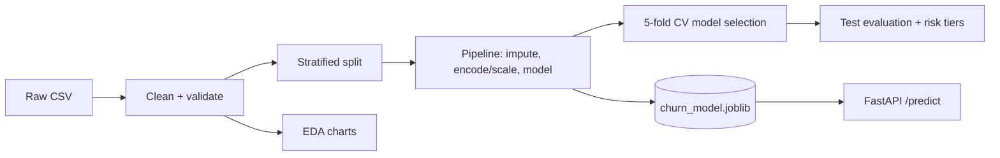

# Customer Churn Prediction & Data Science Analytics

An end-to-end, reproducible machine learning project that predicts which telecom customers are likely to churn, explains the drivers through EDA, segments customers by risk, and serves predictions through a validated FastAPI service.

## Table of Contents
[Overview](#overview) · [Dataset](#dataset) · [Business Use Cases](#business-use-cases) · [Tech Stack](#tech-stack) · [Architecture](#architecture) · [Project Structure](#project-structure) · [Setup](#setup) · [Usage](#usage) · [API](#api) · [Results](#results) · [Testing](#testing) · [Limitations & Responsible Use](#limitations--responsible-use) · [Troubleshooting](#troubleshooting) · [Future Work](#future-work) · [License](#license)

## Overview
**Problem:** acquiring a customer costs more than retaining one, so telecom firms want to find customers likely to leave *before* they do.
**Objective:** predict `Churn` (1 = left, 0 = stayed) from account, service and billing attributes; rank customers by risk.
**Approach:** clean data → EDA → compare four classifiers with leakage-safe scikit-learn pipelines and cross-validation → select on CV ROC-AUC → evaluate once on a held-out test set → risk tiers → API.

## Dataset
- **IBM Telco Customer Churn** (public sample dataset of fictional telecom customers; 21 columns incl. the `Churn` target). Not included in the repo, so please download it yourself and check the license where you get it. Instructions: [`data/README.md`](data/README.md).
- Place it at `data/raw/WA_Fn-UseC_-Telco-Customer-Churn.csv`.
- Data dictionary, quality notes and limitations: [`docs/data_card.md`](docs/data_card.md). Exact row counts and churn rate are computed from your file in `reports/eda_summary.md`.
- No dataset handy? `--use-sample` generates **synthetic** data with the same schema (for demos/tests only; its metrics are meaningless for the real world).

## Business Use Cases
Identify high-risk customers · prioritise retention campaigns · support CRM/customer-success teams · compare churn across contract and service segments · risk-based segmentation (High/Medium/Low) for retention planning. Details and caveats: [`docs/business_insights.md`](docs/business_insights.md).

## Tech Stack
Python 3.10+ · pandas · NumPy · scikit-learn · Matplotlib · Seaborn · joblib · FastAPI · Pydantic · Uvicorn · unittest/pytest

## Architecture

More: [`docs/architecture.md`](docs/architecture.md)

## Project Structure
```
├── churn/                 # source package
│   ├── config.py          # paths, features, seed, risk thresholds
│   ├── data.py            # load / validate / clean
│   ├── preprocessing.py   # ColumnTransformer
│   ├── train.py           # model comparison, selection, reports
│   ├── predict.py         # inference with saved pipeline
│   ├── api.py             # FastAPI app
│   ├── risk.py            # risk tiers + assumption-based revenue exposure
│   ├── eda.py             # charts + summary stats
│   ├── sample_data.py     # synthetic demo data generator
│   └── update_readme.py   # injects generated results into this README
├── tests/                 # automated tests
├── docs/                  # architecture, data card, model card, insights, report, troubleshooting
├── data/                  # raw/ (put CSV here), sample/ (generated)
├── models/                # saved pipeline + metadata (generated)
├── reports/               # metrics, EDA summary, figures (generated)
├── requirements.txt · requirements-dev.txt · LICENSE
```

## Setup
**Linux / macOS**
```bash
git clone https://github.com/bhardwajakshat955-AI-ML/Customer-Churn-Prediction-Data-Science-Analytics.git
cd Customer-Churn-Prediction-Data-Science-Analytics
python3 -m venv .venv && source .venv/bin/activate
pip install -r requirements-dev.txt
```
**Windows (PowerShell)**
```powershell
git clone https://github.com/bhardwajakshat955-AI-ML/Customer-Churn-Prediction-Data-Science-Analytics.git
cd Customer-Churn-Prediction-Data-Science-Analytics
python -m venv .venv
.venv\Scripts\Activate.ps1
pip install -r requirements-dev.txt
```
Then place the dataset as described in [Dataset](#dataset).

## Usage
Run all commands from the repository root (add `--use-sample` to the first two to use synthetic data).
```bash
python -m churn.eda            # charts -> reports/figures, stats -> reports/eda_summary.md
python -m churn.train          # compares models, saves models/churn_model.joblib + reports/
python -m churn.update_readme  # (optional) writes your real metrics/figures into this README
```

## API
```bash
uvicorn churn.api:app --reload      # Swagger UI: http://127.0.0.1:8000/docs
```
Endpoints: `GET /health`, `POST /predict`.

```bash
curl -X POST http://127.0.0.1:8000/predict -H "Content-Type: application/json" -d '{
 "gender":"Female","SeniorCitizen":"No","Partner":"Yes","Dependents":"No","tenure":5,
 "PhoneService":"Yes","MultipleLines":"No","InternetService":"Fiber optic","OnlineSecurity":"No",
 "OnlineBackup":"No","DeviceProtection":"No","TechSupport":"No","StreamingTV":"Yes",
 "StreamingMovies":"Yes","Contract":"Month-to-month","PaperlessBilling":"Yes",
 "PaymentMethod":"Electronic check","MonthlyCharges":95.5,"TotalCharges":480.0}'
```
Response shape (values depend on your trained model):
```json
{"churn_probability": 0.0, "churn_prediction": false, "risk_tier": "Low"}
```
Invalid values (e.g. `"Contract":"Weekly"`) return HTTP 422; a missing model returns HTTP 503 with a message telling you to train.

## Results
Populated from **your** run by `python -m churn.update_readme`. Until then these sections are empty on purpose, because no result is reported that was not measured on the real dataset.

### Model comparison
<!-- METRICS:START -->
_Run `python -m churn.train` then `python -m churn.update_readme`._
<!-- METRICS:END -->

### Charts
<!-- FIGURES:START -->
_Run `python -m churn.eda` and `python -m churn.train`, then `python -m churn.update_readme`._
<!-- FIGURES:END -->

**How to read the metrics:** a false negative is a churner we miss (lost revenue); a false positive is a wasted retention offer. Recall matters for finding at-risk customers, precision for campaign cost, so the model is selected on threshold-independent CV ROC-AUC and the threshold should be tuned with your own cost assumptions. See [`docs/model_card.md`](docs/model_card.md).

## Testing
```bash
python -m unittest discover -s tests -v     # or: pytest
```
API tests need `fastapi`+`httpx` and a trained model (`python -m churn.train`); otherwise they are skipped.

## Limitations & Responsible Use
Single-snapshot data; class-weighted probabilities are not calibrated; correlation is not causation; demographic features may introduce bias; predictions are decision support and need human review, privacy-compliant data handling and controlled tests of any retention offer. Revenue-exposure figures in `reports/risk_segments.csv` use configurable assumptions (`churn/config.py`), not measured outcomes.

## Troubleshooting
See [`docs/setup_troubleshooting.md`](docs/setup_troubleshooting.md).

## Future Work
Hyperparameter tuning · probability calibration · cost-based threshold selection · SHAP explanations · fairness audit · drift monitoring · Docker/CI.

## License
MIT, see [LICENSE](LICENSE). Dataset © its original publisher (IBM sample data); not redistributed here.

**Author:** Akshat Bhardwaj ([@bhardwajakshat955-AI-ML](https://github.com/bhardwajakshat955-AI-ML))
