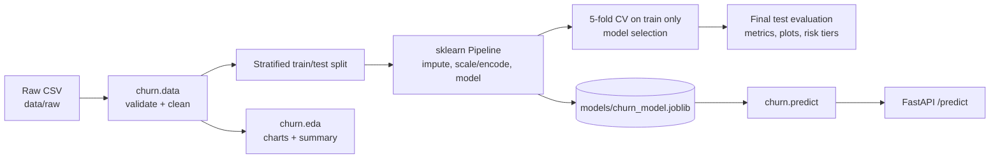

# Architecture

| Module | Responsibility |
|---|---|
| `churn/config.py` | Paths, feature lists, seed, risk thresholds |
| `churn/data.py` | Load, validate schema, clean (stateless → no leakage) |
| `churn/preprocessing.py` | ColumnTransformer (imputer, scaler, one-hot) |
| `churn/train.py` | Compare 4 models, select, evaluate, save artifacts/reports |
| `churn/predict.py` | Load pipeline, enforce column order, score |
| `churn/api.py` | FastAPI app with Pydantic validation |
| `churn/risk.py` | High/Medium/Low segmentation, assumption-based revenue exposure |
| `churn/eda.py` | Charts and statistics computed from the data |

**Leakage controls:** the split happens before any fitting; imputation, scaling and encoding live inside the `Pipeline`, so they are refit on each CV training fold; model selection uses CV on the training split only; the test set is used once for final reporting. `customerID` is dropped from features.

The saved artifact is the *whole pipeline*, so training and serving use identical transformations and column order.
